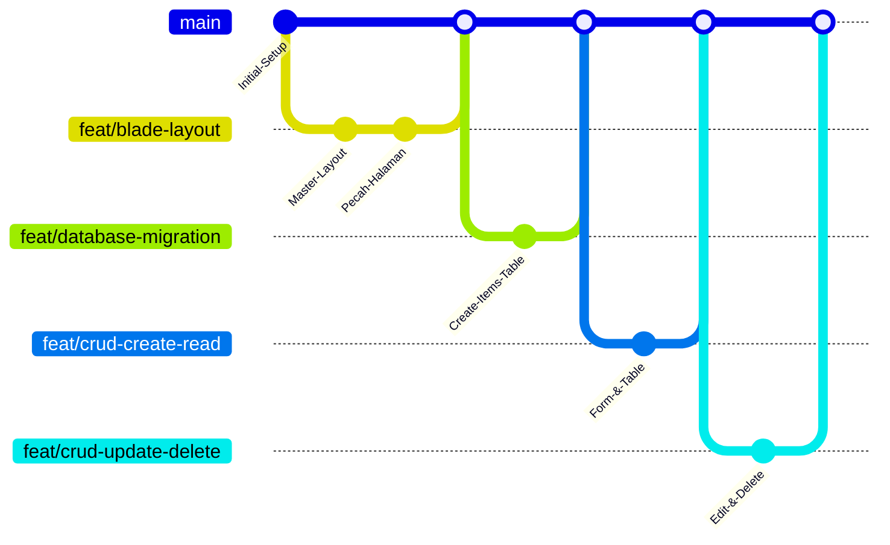

# 🚀 Starter Repo: Fundamental Laravel untuk SMK (Kelas 10 & 11)

Repositori starter pembelajaran pemrograman web dengan Framework Laravel tingkat pemula untuk siswa SMK (Rekayasa Perangkat Lunak / Pengembangan Perangkat Lunak dan Gim).

- **Studi Kasus:** Sistem Inventaris Barang Lab Komputer
- **Target Akhir:** Siswa mampu membuat aplikasi CRUD satu tabel mandiri berbasis arsitektur MVC dan mempraktikkan alur kerja Git/GitHub secara profesional (Pull Request, Branching, dan pencegahan merge conflict).

---

## 📋 Struktur Silabus Pembelajaran (6 Modul)

| Modul | Topik Pembelajaran | Fokus Materi (Ramah Pemula) | Target Output Siswa |
| :--- | :--- | :--- | :--- |
| **Modul 1** | **Pengenalan & Setup** | Analogi bangun rumah (PHP Native = cetak bata sendiri vs Laravel = bata & rangka siap pasang), Composer, struktur folder, `php artisan serve`. | Proyek berjalan di lokal dan terhubung ke GitHub. |
| **Modul 2** | **Routing & Controller** | Alur request MVC (Browser &rarr; Route `web.php` &rarr; Controller &rarr; View), `php artisan make:controller`, passing data. | Siswa paham alur data request & response. |
| **Modul 3** | **Blade Templating** | Syntax Blade (`{{ $data }}`, `@foreach`, `@if`), konsep layouting (`@extends`, `@yield`, `@section`) agar navbar/footer tidak di-copy-paste. | Template statis berubah dinamis & rapi. |
| **Modul 4** | **Database & Migration** | Konfigurasi `.env`, konsep Migration sebagai version control skema tabel di Git, `php artisan migrate`. | Tabel terbentuk tanpa buat manual di phpMyAdmin. |
| **Modul 5** | **Eloquent ORM (Read & Create)** | Model (`php artisan make:model`), `Model::all()`, form input, proteksi `@csrf`, dan `Model::create()`. | Data form tersimpan ke DB & tampil di tabel. |
| **Modul 6** | **Penyelesaian CRUD & Validasi** | Ambil data spesifik (`findOrFail`), update (`PUT`), hapus (`DELETE`), dan validasi input (`$request->validate()`). | CRUD 1 tabel utuh selesai dengan validasi. |

---

## 🛠️ Panduan Menghidupkan Proyek (Bagi Siswa yang Melakukan Clone)

> **Catatan Penting untuk Siswa:**  
> File `.env` dan folder `vendor/` **sengaja tidak di-push ke GitHub** (masuk `.gitignore`).  
> Mengapa?
> 1. Agar ukuran repository ringan dan cepat saat di-clone.
> 2. Menjaga keamanan data sensitif (password database & API key).
> 
> Karena itu, setiap kali kalian clone repositori Laravel, lakukan langkah berikut:

```bash
# 1. Clone repositori ke komputer kalian
git clone <URL_REPOSITORI_GITHUB>
cd laravel

# 2. Unduh dependensi Laravel (folder vendor)
composer install

# 3. Buat file konfigurasi .env dari template
cp .env.example .env

# 4. Generate App Key unik
php artisan key:generate

# 5. Jalankan migrasi database SQLite
php artisan migrate

# 6. Jalankan server lokal
php artisan serve
```

Buka browser dan akses: `http://127.0.0.1:8000`

---

## 📂 Lokasi Template Statis yang Harus Dipecah Siswa

Mentor telah menyiapkan template HTML/Bootstrap sederhana yang belum dinamis:
- Preview via browser: `http://127.0.0.1:8000/template-statis`
- File Blade statis: `resources/views/template_statis/`
- File HTML murni: `public/template_mentah/`

---

## 🌿 Alur Kerja Tugas dengan GitHub Branching (Workflow Siswa)

Siswa dilarang langsung melakukan push ke branch `main`. Setiap pengerjaan tugas modul wajib menggunakan fitur **Branching & Pull Request (PR)**:



### Daftar Branch Penugasan:
1. `feat/blade-layout`: Memecah template mentah menjadi Master Layout Blade (`app.blade.php`), menyusun `@yield`, `@section`, serta route & controller untuk menampilkannya.
2. `feat/database-migration`: Membuat migrasi tabel `items` (kolom: `id`, `kode_barang`, `nama_barang`, `kategori`, `stok`, `kondisi`) dan Model `Item`.
3. `feat/crud-create-read`: Membuat form tambah data barang baru, validasi input, simpan ke database, dan tampilkan di tabel utama.
4. `feat/crud-update-delete`: Membuat fitur edit data barang, update ke DB, dan fitur hapus barang.

---

## 👥 Simulasi Kerja Kolompok Mini (Tim 2 Siswa)

Untuk melatih simulasi kerja tim dan penanganan konflik kode (*merge conflict*):
- **Siswa A:** Bertugas di branch `feat/create-read` (Tampil data & Tambah data).
- **Siswa B:** Bertugas di branch `feat/update-delete` (Edit data & Hapus data).
- **Momen Belajar:** Karena keduanya menyentuh `routes/web.php` dan `ItemController.php`, saat proses Merge ke branch `main` akan timbul *conflict* ringan yang harus mereka diskusikan dan selesaikan bersama.
